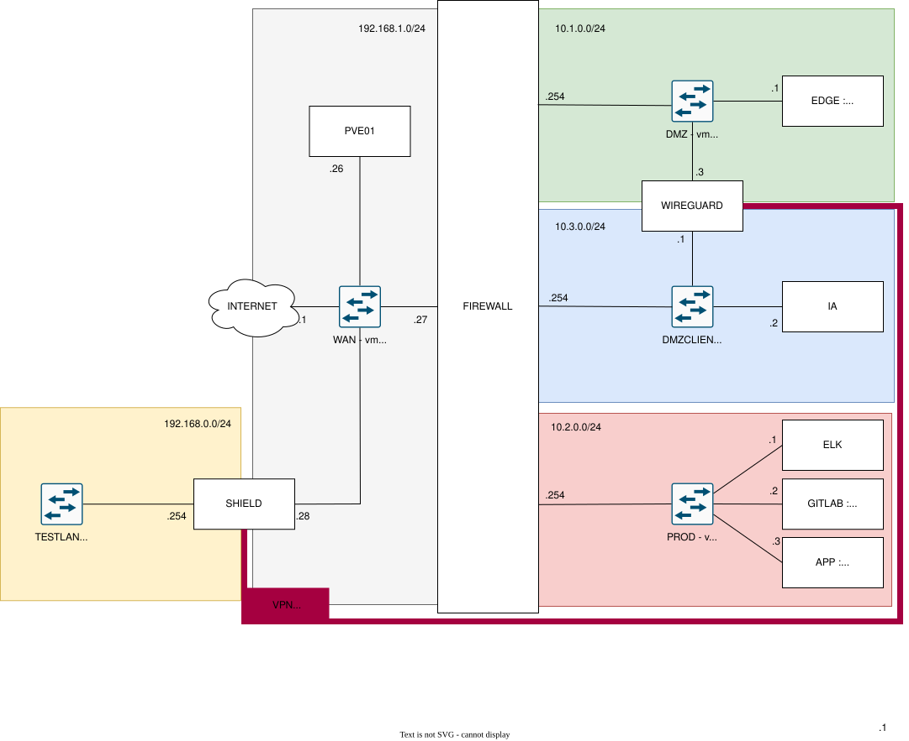

# TEZCAT Infrastructure



## Services de l'infrastructures

### Proxmox
 Hyperviseur hote de toutes les VMs contenant nos services. Il sera accompagné de Terraform et Ansible pour Redeployer l'infra. 
 ```
 Nom : PVE01  
 Réseau : ALL  
 Dépendance : N/A  
 Secret : API Token Terraform  
 Image : Debian 13 + Proxmox & tools
 Données : N/A
 ```

### NFTable
 Pare-feu bloquant tous les flux non désiré dans l'infrastructure. 
 ```
 Nom : FIREWALL  
 Réseau : ALL  
 Dépendance : N/A  
 Secret : Clé d'accès d'admin  
 Image : Debian 13 + NFTables
 Données : Stateless
 ```

### GitLab 
 Gestionnaire de version et un outils de travail collaboratif utile aux projets en cours de Tezcat. C'est ici qu'est stocké code, documentations et images.  
 ```
 Nom : GITLAB  
 Réseau : PROD  
 Dépendances : Nginx, GitLab Runner  
 Port : HTTP/HTTPS Interne par Nginx, ssh git 22  
 Secrets : Mdp root, Token CI.CD, token Runner  
 Image : gitlab/gitlab-ce:<version??>  
 Données : Repos, base interne, registry d'images, uploads
```

### GitLab Runner
Service permettant de déployer la CI/CD.  
```
 Nom : GITLAB-RUNNER  
 Réseau : PROD
 Dépendances : GitLab, accès docker (scket ou dind???)  
 Port : N/A (connexion sortante vers gitlab??)  
 Secrets : Runner Token  
 Image : gitlab/gitlab-runner:<version??>
 ATTENTION : Si le socket docker est monté, le runner est root sur docker, a restrindre !!!  
 Données : Stateless
```

### SOPS/age 
Gestion des secrets de l'infrastructure. Ils permettent de chiffrer des secrets directement dans les fichiers poussés sur GitLab.  
```
 Nom : SOPS/age   
 Réseau : N/A  
 Dépendance : clée privé age sur l'hote de déploiement / dans le pipeline  
 Port : N/A  
 Secrets : clée privé age = racine de confiance (hors git dans bitwarden)  
 Image : binaire installé sur l'hote   
 Données : Stateless
```

### Nginx
 Reverse proxy, couplé à **certbot** pour le TLS 
 ```
 Nom : NGINX  
 Réseau : DMZ  
 Dépendances : Certbot (TLS), upstream : Webfront, GitLab,...  
 Port : 80, 443  
 Secrets : certificats TLS de certbot, htpasswd  
 Image : nginx:<version??>
 Données : Stateless
 ```

### Certbot
Client qui obtient et renouvelle les cert tls pour que nginx gere le https.
```  
 Nom : CERTBOT
 Réseau : DMZ
 Dépendances : Nginx, accès sortant ACME, api DNS si challenge DNS-01 
 Port : N/A
 Secrets : clé de compte acme, token api DNS
 Image: certbot/certbot:<version??>
 Données : Certificats émis
 ```

### WireGuard
Gestionnaire de tunnels vpn pour acceder aux Shields des clients.  
```
 Nom : WIREGUARD  
 Réseau : DMZ & DMZCLIENT  
 Dépendances : DNAT 51820 depuis le pare-feu  
 Port : 51820/UDP  
 Secrets : Clés privées Wireguard (serveur + pairs clients)  
 Image : linuxserver/wireguard:<version??>
 Données : Clés serveur + config des pairs
```

### ELK 
Regroupement (stack) de plusieurs services complémentaires communiquant entre eux (ElasticSearch, Logstash et Kibana) qui permettent de centraliser les logs recus par les Shields.  
```
 Nom : ELK  
 Réseau : PROD  
 Dépendances : reçoit Filebeat des Shields via DMZCLIENT (5044) · l'IA lit via API  
 Port : Elasticsearch 9200 · Kibana 5601 · Logstash/beats 5044  
 Secrets : Mdp elastic, clés api, cert TLS transport filebeats  
 Image : elasticsearch / logstash / kibana  
 ATTENTION : Sécuriser l'entrée 5044 : TLS + authentification (anti-injection de logs)  
 Données : Index Elasticsearch
```

### Shield (test) 
Solution virtualisé a installer chez le client. Elle permet d'avoir un environement de test local (qui fonctionne par VPN comme un vrai client). Elle utilise **Filebeat** pour rapatrier les logs et **Iptables** (à remplacer avec NFTables) pour appliquer les règles de pare-feu.    
```
 Nom : SHIELD-TEST  
 Réseau : TESTLAN, WAN 
 Dépendances : Filebeat vers ELK 5044, recoit sa config de l'IA, (via WG)  
 Port : sortant 5044, entrant 22 (via WG)  
 Secrets : clé Wireguad, clé SSH, clé api filebeat/ELK  
 Image : Debian 13 + Filebeat+ nftables (remplacer iptables)  
 Données : Stateless
```

### IA 
Environnement ou on sera amané a faire tourner tous les services (arbres de décision, LLM, ...). Afin d'analyser les logs et configurer les Shields.  
```
 Nom : IA  
 Réseau : DMZCLIENT  
 Dépendances : lit ELK (LAN via clé api), configure shield (SSH via WG)  
 Port : sortant vers ELK (9200/443), sortant ssh vers shields  
 Secrets : clé api ELK, clé ssh vers shield, secret modèles LLM  
 Image : Debian 13 + Python3  
 Données : Modèles LLM et leurs poids si LLM local.
```

### Web-Front 
Application web de notre solution accessible aux clients.  
```
 Nom : WEB-FRONT  
 Réseau : DMZ  
 Dépendances : Nginx (exposition), web back api  
 Port : port nginx d'expo 
 Secrets : éventielles clés API publiques  
 Image : JULES ?
 Données : Stateless
```

### Web-Back
Gestion des données du site web et sa communication avec les autres services c'est ce qui le rend techniquement utile.
```
 Nom : WEB-BACK  
 Réseau : PROD  
 Dépendances : Postgres,  ELK api   
 Port : port api interne  
 Secrets : identifiants bdd ,cle jtw/session, clé api web front et clé api elk  
 Image : JULES ? 
 Données : Stateless
```

### PostgreSQL 
Base de donnés pour l'application web.   
```
 Nom : BDD  
 Réseau : PROD  
 Dépendances : Web-Back  
 Port : 5432 uniquement en interne  
 Secrets : mdp et roles PostgreSQL  
 Image : postgres:<version???>
 Données : Le répertoire de donnée
```

 ## Table des Flux 
 Politique par défaut : DROP. Tout flux non listé est refusé.
 
 | Source | Destination | Port | Protocole | Autorisation | Description |
 |--------|-------------|------|-----------|--------------|-------------|
 | Internet | Nginx (DMZ) | 80 | TCP | Autorisé | HTTP - Redirection vers 443 + challenge ACME certbot |
 | Internet | Nginx (DMZ) | 443 | TCP | Autorisé | HTTPS - Accès au Web-Front  |
 | Internet | Wireguard (DMZ) | 51820 | UDP | Autorisé | Tunnels VPN des Shields clients et accès admin à l'infra (DNAT depuis WAN) |
 | Nginx (DMZ) | Web-Front (DMZ) | JULES? | TCP | Autorisé | Proxy vers le front |
 | Nginx (DMZ) | Web-Back (PROD) | JULES? | TCP | Autorisé | Proxy /api vers le back (seulement si c'est le navigateur qui fait des appels au back (JULES ?)) |
 | Admin/Dev (WG) | GitLab (PROD) | 443 | TCP | Autorisé | Accès web au gitlab (VPN uniquement) |
 | Admin/Dev (WG) | Gitlab (PROD) | 22 | TCP | Autorosé | git push/pull en SSH (VPN uniquement) |
 | Web-Back (PROD) | Bdd (PROD) | 5432 | TCP |Autorisé | Accès Bdd (intra PROD) | 
 | Web-Back (PROD) | ELK (PROD) | 9200 | TCP | Autorisé | Lecture des logs à afficher sur le site |
 | GitLab-Runner (PROD) | GitLab(PROD) | 443 | TCP | Autorisé | Récupération des Jobs CI (intra PROD) |
 | GitLab-Runner (PROD) | Internet (registries) | 443 | TCP | Autorisé | Pull d'images & dépendences (restrindre aux registries) |
 | GitLab-Runner (PROD) | Hôtes de déploiement | 22 | TCP | Autorisé | Déploiement via SSH (selon cibles) |
 | Shield (WG) | ELK (PROD) | 5044 | TCP | Autorisé | Filebeat vers Logstash | 
 | IA (DMZCLIENT) | ELK (PROD) | 9200 | TCP | Autorisé | Lecture des logs à traiter |
 | IA (DMZCLIENT) | Shield (WG) | 22 | TCP | Autorisé | Push des règles NFTables par SSH | 
 | Admin (WG) | Kibana (PROD) | 5601 | TCP | Autorisé | Consultation des logs |
 | Admin (WG) | Tous les hôtes | 22 | TCP | Autorisé | Administration SSH |
 | Admin (WG) | Proxmox | 8006 | TCP | Autorisé | Gestion de l'Hyperviseur
 | Certbot (DMZ) | Internet (Let's encrypt) | 443 | TCP | Autorisé | Emission / Renouvellement des certificats ACME | 

 ## Répartition des Services 

 | VM | Réseau | Service | RAM |
 |----|--------|---------|-----|
 | FIREWALL | DMZ + DMZ CLIENT + PROD + WAN | NFTables | 1 Go |
 | WIREGUARD | DMZ + DMZCLIENT | WireGuard | 1 Go |
 | EDGE | DMZ | NGINX + CERTBOT + WEB-FRONT | 2 Go |
 | GITLAB | PROD | GITLAB + GITLAB-RUNNER | 6 Go |
 | ELK | PROD | ElasticSearch + Logstash + Kibana | 4 Go | 
 | APP | PROD | WEB-BACK + BDD | 2 Go |
 | IA | DMZCLIENT | IA | 2 Go |
 | SHIELD-TEST | TESTLAN + WAN | SHIELD | 2 Go |

## DNS & Domaines

### Public (chez le registrar)
| Nom            | Type | Valeur          | Service    |
|----------------|------|-----------------|------------|
| www.tezcat-app.fr      | A    | IP_PUBLIQUE   | Web-Front  |
| vpn.tezcat-app.fr  | A    | IP_PUBLIQUE   | WireGuard  |

### Interne (via /etc/hosts pour l'instant, DNS dédié plus tard) 
| Nom                  | IP privée      | Service |
|----------------------|----------------|---------|
| gitlab.tezcat-app.fr   | 10.2.0.2    | GitLab  |
| kibana.tezcat-app.fr   | 10.2.0.1    | Kibana  |
| proxmox.tezcat-app.fr  | 192.168.1.26    | Proxmox |

## Sécurité Wireguard

Les utilisateur sont répartis en 4 groupes.  
| Groupe | Plage | IP Accessibles | DNS |
|--------|-------|-------|-----|
| Admin | 10.0.0.0/24 | Tout | gitLab, kibana, proxmox.tezcat-app.fr |
| Dev | 10.0.1.0/24 | GitLab | gitlab.tezcat-app.fr |
| Test |  10.0.2.0/24 | ELK,(IA) | Aucun
| Clients |  10.0.3.0-10.0.255.0/24 | ELK,(IA) | Aucun

